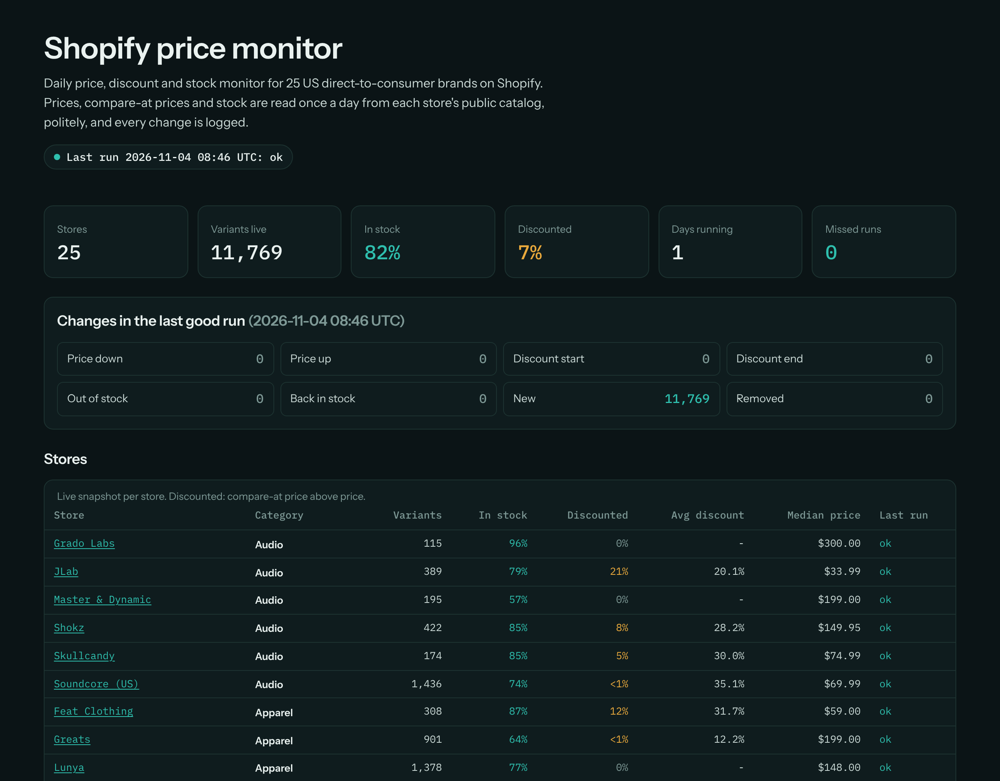

<p align="center"><picture><source media="(prefers-reduced-motion: reduce)" srcset="assets/hero-still.svg"></picture></p>

# Shopify price monitor

**Every price, sale and stock change from 25 US online stores, checked every day and delivered as a clean spreadsheet.**

[](https://github.com/siddharthkumarx/ecommerce-price-monitor/actions/workflows/daily.yml)
[](https://github.com/siddharthkumarx/ecommerce-price-monitor/blob/main/data/runs.jsonl)
[](https://github.com/siddharthkumarx/ecommerce-price-monitor/blob/main/data/status.json)
[](https://github.com/siddharthkumarx/ecommerce-price-monitor/blob/main/data/latest/snapshot.csv)
[](https://github.com/siddharthkumarx/ecommerce-price-monitor/actions/workflows/ci.yml)

**[Live dashboard](https://siddharthkumar.com/ecommerce-price-monitor/)** · **[Download the data](https://github.com/siddharthkumarx/ecommerce-price-monitor/releases/latest)**

## What you get

One row per product option (size, colour) per store, with today's price, the "was" price when it is on sale, and whether it is in stock. A sample from the run of 5 November 2026:

| Store | Product | Price | Was | In stock |
|---|---|---:|---:|:---:|
| Big Agnes | [Fly Creek HV 1 Carbon Footprint](https://www.bigagnes.com/products/fly-creek-hv-1-carbon-footprint) | $35.00 | $70.00 | yes |
| Year & Day | [All Day & Night Dip Dishes (Fog)](https://yearandday.com/products/all-day-night-dip-dishes-2) | $22.00 | $44.00 | yes |
| Shokz | [OpenMeet (Black / No Adapter)](https://shokz.com/products/openmeet) | $119.95 | $219.95 | yes |
| Jones Road | [The Makeup Travel Kit 2.0 (Dark)](https://www.jonesroadbeauty.com/products/the-makeup-travel-kit-2-0) | $98.00 | $172.00 | yes |
| Feat Clothing | [The Men's Standard Joggers - Limited (Pacific / S)](https://featclothing.com/products/mens-roam-joggers-limited-edition-fall-colors) | $59.00 | $88.00 | yes |

The full table has 11,767 rows: [CSV](https://github.com/siddharthkumarx/ecommerce-price-monitor/blob/main/data/latest/snapshot.csv) · [monthly history](https://github.com/siddharthkumarx/ecommerce-price-monitor/releases/latest) · [dashboard](https://siddharthkumar.com/ecommerce-price-monitor/).

### What changed today

In the run of 5 November 2026: 45 price rises, 28 items sold out, 18 items back in stock, 13 new product options, 15 product options removed. The biggest moves:

| Store | Product | What changed | Before | Now |
|---|---|---|---:|---:|
| Soundcore (US) | [Liberty 5 (Refurbished) (Black)](https://us.soundcore.com/products/soundcore-liberty-5-refurbished) | Price up (+100.1%) | $64.95 | $129.99 |
| Soundcore (US) | [Liberty 5 (Refurbished) (Navy Blue)](https://us.soundcore.com/products/soundcore-liberty-5-refurbished) | Price up (+100.0%) | $64.99 | $129.99 |
| Soundcore (US) | [Life A2 NC \| Bluetooth Noise Cancelling Earbuds (Black)](https://us.soundcore.com/products/life-a2-nc) | Price up (+16.7%) | $59.99 | $69.99 |
| State & Liberty | [Athletic Fit Stretch Wool Suit Pants - Charcoal with Ash Mini Stripe (29 / Charcoal with Ash Mini Stripe)](https://stateandliberty.com/products/athletic-fit-stretch-wool-suit-pants-charcoal-with-ash-mini-stripe) | Price up (+11.1%) | $180.00 | $200.00 |
| State & Liberty | [Athletic Fit Stretch Wool Suit Pants - Charcoal with Ash Mini Stripe (30 / Charcoal with Ash Mini Stripe)](https://stateandliberty.com/products/athletic-fit-stretch-wool-suit-pants-charcoal-with-ash-mini-stripe) | Price up (+11.1%) | $180.00 | $200.00 |
| State & Liberty | [Athletic Fit Stretch Wool Suit Pants - Charcoal with Ash Mini Stripe (31 / Charcoal with Ash Mini Stripe)](https://stateandliberty.com/products/athletic-fit-stretch-wool-suit-pants-charcoal-with-ash-mini-stripe) | Price up (+11.1%) | $180.00 | $200.00 |
| State & Liberty | [Athletic Fit Stretch Wool Suit Pants - Charcoal with Ash Mini Stripe (32 / Charcoal with Ash Mini Stripe)](https://stateandliberty.com/products/athletic-fit-stretch-wool-suit-pants-charcoal-with-ash-mini-stripe) | Price up (+11.1%) | $180.00 | $200.00 |
| State & Liberty | [Athletic Fit Stretch Wool Suit Pants - Charcoal with Ash Mini Stripe (33 / Charcoal with Ash Mini Stripe)](https://stateandliberty.com/products/athletic-fit-stretch-wool-suit-pants-charcoal-with-ash-mini-stripe) | Price up (+11.1%) | $180.00 | $200.00 |

Every change is in the [daily change log](https://github.com/siddharthkumarx/ecommerce-price-monitor/tree/main/data/changes).

## Why you can trust this data

- **Checked against a second source.** Every run reads each store's full product list, then checks one product from every store against a second source on the same store. Latest run: 25 of 25 checked products matched exactly.
- **Real US prices.** Every request asks for US prices, and every run proves that the store showed US dollars. Latest run: 24 of 25 stores proved US dollars.
- **Doubtful data is held back, not guessed.** A row that breaks a rule (for example a sale price above the normal price) is set aside, and a run that looks wrong as a whole is held: yesterday's good data stays live until a clean run replaces it. Latest run: 0 rows set aside, 216 free gifts and samples left out on purpose, not held.
- **Nothing silently missing.** A store that could not be read keeps its last good prices and is marked as not updated, so you always know how fresh each row is. Latest run: 24 of 25 stores updated; 1 kept their previous prices.
- **Collected politely.** One store page every few seconds, the stores' own rules respected, and the run slows down or stops as soon as a store asks. Latest run: 110 page requests in 9.9 minutes, and no store blocked us.

## How it works

<p align="center"><picture><source media="(prefers-reduced-motion: reduce)" srcset="assets/pipeline-still.svg"></picture></p>

1. **Collect.** Once a day, a scheduled job reads the public product catalog of each store, slowly and with the stores' rules respected.
2. **Check.** Each price is checked for obvious errors (above zero, sale price below the "was" price), and one product per store is compared with a second source.
3. **Store.** Every change is kept with the time it happened, so you can see what any product cost on any day.
4. **Deliver.** The latest prices as CSV, a daily change log, a monthly history file, an optional Google Sheet and a [live dashboard](https://siddharthkumar.com/ecommerce-price-monitor/).

<p align="center"></p>

## What broke and how I fixed it

<p align="center"><picture><source media="(prefers-reduced-motion: reduce)" srcset="assets/maintenance-loop-still.svg"></picture></p>

Real problems from building this monitor, with the fix for each. The full write-ups are in [docs/incidents.md](docs/incidents.md).

- **Too fast for a shared host.** Each store was read slowly, but all these stores run on Shopify's servers, and together the requests were too fast. Fix: one pace for the whole run, plus an automatic stop if several stores push back at once.
- **Free gifts looked like errors.** Free samples have a price of zero, and the checks treated them as broken data and held a whole run. Fix: free items are now left out on purpose and counted separately.
- **"Slow down" was obeyed by one store only.** When Shopify asked us to wait a minute, only that store waited while the others carried on. Fix: when Shopify asks, every store pauses together, and the pace eases back only after a run of clean answers.
- **Testing hit Shopify's rate limit.** Fix: the run stops politely instead of retrying, the store list was trimmed, and test runs are rationed.

## Who uses data like this

- **Store owners and pricing managers:** see the day a competitor starts a sale, how deep it goes, and when it ends, without checking sites by hand.
- **Brand and category managers:** follow price levels, sale depth and stock across a whole category, store by store.
- **Analysts:** a clean daily history of prices and stock for trend reports, such as how deep Black Friday discounts go by category.

## Want this for your own sites?

I build and run monitors like this one for any set of online stores or websites.

- **Free sample first:** 20-50 real rows from your target sites before you pay anything.
- **Fixed price:** a fixed monthly fee for a running monitor, or a one-time price for a single collection.
- **Data on schedule:** daily or weekly, delivered as CSV, Excel, Google Sheets or a database.

**Contact:** [hello@siddharthkumar.com](mailto:hello@siddharthkumar.com) · [siddharthkumar.com](https://siddharthkumar.com)

## FAQ

**How fresh is the data?**
Every store is read once a day, in the early morning US time. Each row shows when its current price was first seen, and the [last run badge](https://github.com/siddharthkumarx/ecommerce-price-monitor/actions/workflows/daily.yml) shows the time of the latest run.

**What happens when a site changes?**
The checks notice it: a run that looks wrong is held and I get an alert, while the last good data stays live. I fix the collector, usually the same day, and the next run fills the gap.

**Which formats can I get?**
CSV, Excel, Google Sheets or a database, plus a monthly history file (Parquet) if you want one. This repository delivers CSV, Parquet and a dashboard.

**Can you track my competitors' sites?**
Yes, if the information is public, such as prices, sales and stock on product pages. I check each site first and tell you what can be collected and how often, before any work starts.

**Is it legal and polite?**
It reads only public pages, follows each site's published rules (robots.txt), goes slowly, stops when a site asks, and collects no personal data. Site owners can ask for removal at any time (see [Data use and compliance](#data-use-and-compliance)).

**How does pricing work?**
After the free sample, you get a quote: a fixed monthly price for a running monitor, or a one-time price for a single collection. No hourly billing.

## Data dictionary

The latest prices, [`data/latest/snapshot.csv`](https://github.com/siddharthkumarx/ecommerce-price-monitor/blob/main/data/latest/snapshot.csv), one row per product option. Examples are from the run of 5 November 2026.

| Field | Type | Meaning | Example |
|---|---|---|---|
| `store_id` | text | Store, as listed in `config/stores.yml` | `big-agnes` |
| `product_id` | integer | The store's product id | `7743106154745` |
| `variant_id` | integer | The store's id for this option (size, colour); unique per store | `43184969089273` |
| `handle` | text | Product address: `https://<store>/products/<handle>` | `fly-creek-hv-1-carbon-footprint` |
| `product_title` | text | Product name as shown by the store | `Fly Creek HV 1 Carbon Footprint` |
| `variant_title` | text | Option name (`Default Title` when there is only one) | `Default Title` |
| `price_cents` | integer | Current price in US cents | `3500` |
| `compare_at_cents` | integer or empty | "Was" price in US cents when on sale, else empty | `7000` |
| `available` | true/false | In stock | `true` |
| `valid_from` | UTC time | When this price and stock state was first seen | `2026-11-04T08:46:55Z` |

The daily change log, [`data/changes/YYYY/YYYY-MM-DD.csv`](https://github.com/siddharthkumarx/ecommerce-price-monitor/tree/main/data/changes), one row per change:

| Field | Type | Meaning | Example |
|---|---|---|---|
| `observed_at` | UTC time | Run that saw the change | `2026-11-05T09:41:31Z` |
| `store_id` | text | Store | `bee-s-wrap` |
| `variant_id` | integer | Product option | `53186903736595` |
| `product_title` | text | Product name | `Bread Bag` |
| `event` | text | One of: `price_down`, `price_up`, `discount_start`, `discount_end`, `out_of_stock`, `back_in_stock`, `new`, `removed` | `out_of_stock` |
| `old_price_cents` | integer or empty | Price before, US cents | `1999` |
| `new_price_cents` | integer or empty | Price after, US cents | `1999` |
| `old_compare_at_cents` | integer or empty | "Was" price before | `(empty)` |
| `new_compare_at_cents` | integer or empty | "Was" price after | `(empty)` |
| `price_change_pct` | number or empty | Price change in percent, for price events | `(empty)` |

The monthly history, `price_history_YYYY-MM.parquet` in the [releases](https://github.com/siddharthkumarx/ecommerce-price-monitor/releases), has the snapshot fields for every version of every row, plus `valid_to` (UTC time the version was replaced; empty while it is current) and `exported_at` (UTC time of the run that wrote the file).

<details>
<summary><strong>For engineers</strong></summary>

### Architecture

One scheduled GitHub Actions job (`.github/workflows/daily.yml`) runs `python -m pricemon.run`:

1. **Fetch** (`polite.py`, `fetch.py`): robots.txt per RFC 9309 (Protego), `/products.json` pages with `country=US`, then one product per store per day cross-checked against `/products/<handle>.js` and the page's JSON-LD. Per-store delay with jitter, one run-wide pace for Shopify's shared edge (`EdgeGuard`): any 429 pauses every store for its `Retry-After` and slows the pace; a challenge page stops a store; persistent throttling halts the run; a 38-minute request budget keeps the job under 45 minutes.
2. **Validate** (`models.py`, `normalize.py`, `guard.py`): Pydantic rows (integer cents, `compare_at >= price`, fixed availability values), then a batch guard that holds the run on row-count drops, unit-error price moves, unexplained mass changes, rejects or a non-USD currency proof.
3. **History** (`history.py`, `changes.py`): an SCD2 merge in DuckDB; open versions are the committed snapshot, closed versions go to the monthly Parquet release asset.
4. **Outputs** (`outputs.py`, `sheets.py`, `site.py`, `readme.py`, `visuals.py`): change log, `runs.jsonl`, `status.json` and shields.io badges, Google Sheet, static dashboard, and this README with its visuals, re-rendered after every run.

Full design: [docs/architecture.md](docs/architecture.md).

### Data model

`price_history(store_id, product_id, variant_id, handle, product_title, variant_title, price_cents, compare_at_cents, available, valid_from, valid_to)`, keyed by `(store_id, variant_id, valid_from)`. A change in price, compare-at price or availability closes the open version and opens a new one; stores not fetched completely in a run carry their open versions over unchanged.

### Repository layout

```
src/pricemon/   pipeline modules (polite, fetch, normalize, guard, history, changes, outputs, ...)
config/         stores.yml (generated from recon evidence), screen-review.yml, public.yml
checks/         live-check requests and their committed results (recon, dry runs)
data/           outputs committed by every run: snapshot, change logs, run log, badges
templates/      README and dataset-card templates
assets/         visuals (generated) and icons
docs/           architecture, decisions, incidents, sources, build progress
tests/          pytest with golden fixtures
```

### Run it locally

```bash
uv sync
uv run pytest
uv run python -m pricemon.site --data data --out site
uv run python -m pricemon.visuals --data data --out assets
uv run python -m pricemon.readme
```

The collector itself (`uv run python -m pricemon.run`) is meant for the scheduled runner; run it from your own machine only against stores you are allowed to collect, at the same pace.

### Tests and CI

The test suite (`uv run pytest`) covers a golden two-run SCD2 scenario, Shopify-shaped fixtures for every witness, guard thresholds, retry and robots rules, workflow structure. CI (`.github/workflows/ci.yml`) runs ruff, mypy (strict), pytest, gitleaks over the full history, pip-audit on the lockfile, and a commit-message policy check.

### Key decisions

All in [docs/decisions.md](docs/decisions.md); the ones that shape the system:

- [D-004](docs/decisions.md#d-004---store-selection-and-drop-rules-2026-11-03-owner-rules): a store is dropped for any challenge, 429 retry or disallowed path in any recon run.
- [D-006](docs/decisions.md#d-006---currency-proof-holds-the-run-2026-11-03-owner-rule): a non-USD currency proof holds the whole run.
- [D-009](docs/decisions.md#d-009---where-state-lives-2026-11-03): open versions in git, full history in monthly Parquet.
- [D-019](docs/decisions.md#d-019---json-ld-is-a-soft-witness-for-prices-2026-11-04): JSON-LD is a soft price witness.
- [D-020](docs/decisions.md#d-020---45-minute-run-on-one-runner-25-stores-2026-11-04-owner-decision): a 45-minute run on one runner, reached with a smaller store list, never by spreading requests over more IPs.

Store register with every dropped candidate and its evidence: [docs/sources.md](docs/sources.md).

</details>

## Data use and compliance

- Only public product pages and public catalog feeds are read; nothing behind a login.
- robots.txt is respected, requests are slow and spaced, and a store that asks us to wait or stop is obeyed.
- No personal data is collected.
- No product images or descriptions are stored or republished: only prices, sale prices, stock and product names.
- Store owners can opt out: email [hello@siddharthkumar.com](mailto:hello@siddharthkumar.com) and the store is removed within 24 hours.

## License

The code is under the [MIT License](LICENSE). The data is a compilation of public facts (prices and stock) shared under [CC BY 4.0](https://creativecommons.org/licenses/by/4.0/); store and product names belong to their owners. See the [dataset card](data/README.md).

Built and maintained by Siddharth Kumar · [siddharthkumar.com](https://siddharthkumar.com)
